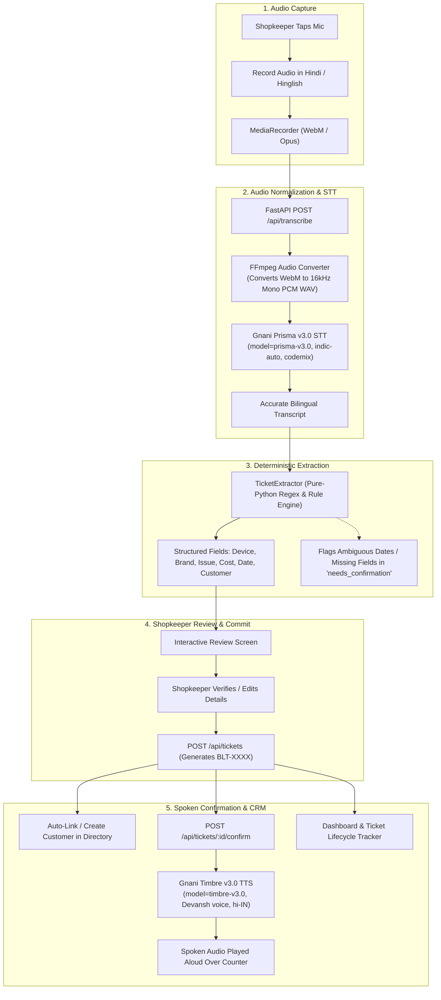
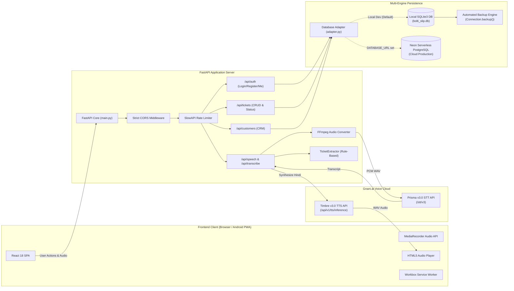

# Bolti Slip (बोलती स्लिप)

<div align="center">


**"जो बोला, वही लिखा। जो लिखा, वही कन्फ़र्म।"**  
*(Jo Bola, Wahi Likha. Jo Likha, Wahi Confirm.)*

### AI-Powered Voice-to-Repair Ticket SaaS for Indian Local Repair Shops

[](https://gnani.ai)
[-7C3AED?style=flat-square)](https://vachana.ai)
[-6366F1?style=flat-square)](https://vachana.ai)
[](https://fastapi.tiangolo.com)
[](https://react.dev)
[](https://www.typescriptlang.org)
[](https://tailwindcss.com)
[](#key-features)
[](#key-features)
[](#automated-testing--verification)

[Solution Pitch](#the-problem--our-solution) • [Workflow](#how-it-works) • [Features](#key-features) • [Gnani AI Integration](#gnani-ai-integration) • [Architecture](#system-architecture) • [Getting Started](#getting-started) • [Deployment](#production-readiness--deployment)

</div>

---

## 📋 Project Information

| Attribute | Details |
| :--- | :--- |
| **Project Name** | **Bolti Slip (बोलती स्लिप)** |
| **Initiative** | **Great Indian AI Internship Challenge by Gnani.ai** |
| **Official Tagline** | *"Jo Bola, Wahi Likha. Jo Likha, Wahi Confirm."* |
| **Primary Domain** | Micro-SaaS for Electronics, Appliances, and Mobile Repair Shops |
| **GitHub Repository** | [github.com/KankurtiMohammadZiyaouddin/Bolti-Slip](https://github.com/KankurtiMohammadZiyaouddin/Bolti-Slip) |
| **Speech-to-Text (STT)** | **Gnani Prisma v3.0** (`indic-auto`, `codemix`) |
| **Text-to-Speech (TTS)** | **Gnani Timbre v3.0** (`hi-IN`, Voice: `Devansh`) |
| **Frontend Stack** | React 18, TypeScript, Vite 5, Tailwind CSS v4, Workbox PWA |
| **Backend Stack** | FastAPI (Python 3.10+ / 3.14), Uvicorn, SlowAPI, Pydantic v2 |
| **Database Engines** | Dual-Engine: **SQLite** (Local Dev & Auto-Backups) + **Neon PostgreSQL** (Cloud Production) |
| **Deployment Target** | Render Web Service (FastAPI) + Vercel / Render Static (React PWA) |

---

## 💡 The Problem & Our Solution

### The Challenge Faced by Local Repair Shops

India's local electronics, smartphone, and home appliance repair shops operate in fast-paced, high-friction environments:
- **Manual, Fragile Paper Slips:** Shopkeepers write estimates and customer complaints on paper chits that get oil-stained, torn, or misplaced, leading to loss of accountability.
- **Typing Friction with Busy Hands:** Technicians handle dirty components, screwdrivers, and soldering irons. Pausing work to type customer names, serial numbers, and fault descriptions on tiny touchscreen keyboards is slow and cumbersome.
- **Cost and Delivery Date Disputes:** Verbal agreements on repair estimates (*"₹350 me ho jayega"*) or delivery timelines (*"Friday shaam tak le jaana"*) frequently result in customer arguments at pick-up time.
- **Scattered Customer History:** Without a lightweight, searchable record system, shopkeepers cannot track repeat customers, device warranties, or open repair statuses.

### The Bolti Slip Solution

**Bolti Slip** transforms any smartphone or browser into an intelligent, bilingual voice clerk for Indian repair businesses:

1. **Speak Naturally in Hinglish or Hindi:** The shopkeeper taps one button and speaks naturally:  
   > *"Sharma ji ka Samsung refrigerator cooling nahi kar raha. Compressor check karna hai, advance 500 rupaye liya aur Friday tak ready karke dena hai."*
2. **High-Accuracy Speech-to-Text via Gnani Prisma v3.0:** The spoken audio is converted to text using Gnani's proprietary **Prisma v3.0** engine with native Indian code-mixed recognition (`indic-auto`, `codemix`).
3. **Zero-Hallucination Deterministic Extraction:** A pure-Python rule-based extraction engine normalizes the transcription, identifying the customer name, phone number, device category, brand, reported fault, advance payment, estimated cost, and promised delivery date without LLM hallucination.
4. **Spoken Voice Confirmation via Gnani Timbre v3.0:** As soon as the ticket is saved, Gnani's **Timbre v3.0** voice synthesis speaks out an audible Hindi confirmation to the customer right across the counter:  
   > *"आपका रिपेयर टिकट BLT-0005 सफलतापूर्वक तैयार हो गया है। ग्राहक Sharma ji। उपकरण: Samsung Refrigerator। अनुमानित लागत: 500 रुपये। धन्यवाद!"*
5. **Installable Android PWA & CRM:** Generates a permanent digital job card (`BLT-XXXX`), links it to the customer directory, tracks lifecycle stages (`open` → `in_progress` → `resolved` → `closed`), and works offline-ready as an installable Android Progressive Web App.

---

## 🔄 How It Works



### Detailed Workflow Step-by-Step

1. **Secure Shopkeeper Authentication:** The technician registers or logs in with their shop credentials. Sessions are protected via cryptographic bearer tokens and multi-tenant database isolation.
2. **One-Tap Voice Intake:** The technician presses the voice recorder on desktop or mobile. Bolti Slip records the spoken instructions.
3. **Automated Audio Conversion Pipeline:** Mobile browsers typically capture audio in WebM/Opus format. Bolti Slip's backend automatically inspects EBML headers and transparently converts the stream using FFmpeg to 16 kHz 16-bit mono PCM WAV before passing it to Gnani Prisma.
4. **Bilingual Transcription:** Gnani Prisma v3.0 returns the recognized text with detected language metadata and processing timings.
5. **Rule-Based Field Parsing:** The extractor categorizes 16+ consumer electronics categories (Mixer Grinder, TV, Laptop, Fridge, Washing Machine, Geyser, Fan, etc.), top Indian brands (Samsung, LG, Whirlpool, Philips, Bajaj, Havells, etc.), 10-digit Indian mobile numbers, currency values, and delivery dates. Ambiguous relative days (e.g., *"Friday"*) are explicitly highlighted in a `needs_confirmation` alert rather than guessed.
6. **Ticket Review & Validation:** The shopkeeper inspects the generated slip. Any missing fields can be edited directly on the form.
7. **Ticket Creation & Global Numbering:** When committed, the ticket is assigned a sequential tracking identifier (`BLT-0001`, `BLT-0002`) and linked to the customer's phone number.
8. **Spoken Audio Playback:** The backend dynamically synthesizes a natural Hindi confirmation using Gnani Timbre v3.0 and streams raw WAV audio directly to the frontend player.
9. **Dashboard & Lifecycle Tracking:** The job card is visible on the dashboard, where technicians can update statuses from `open` to `in_progress`, `resolved`, and `closed`.

---

## ✨ Key Features

### 🎙️ 1. Bilingual Voice Intake & Transcription
- Native support for Hindi, Indian English, and conversational Hinglish code-mixing.
- Powered directly by the **Gnani Prisma v3.0** STT API (`https://api.vachana.ai/stt/v3`).
- Automatic client-side and server-side audio format normalization (FFmpeg WebM/Opus to PCM WAV).

### ⚙️ 2. Zero-Hallucination Deterministic Extraction
- Pure-Python regex and entity extraction engine (`TicketExtractor`).
- No external LLM dependencies, eliminating hallucinations of critical repair costs, phone numbers, or dates.
- Extracts: **Device Category**, **Brand/Model**, **Customer Name**, **Indian Phone Number**, **Reported Problem**, **Estimated Cost**, **Advance Paid**, and **Delivery Date**.
- Emits explicit `needs_confirmation` warnings for ambiguous relative dates.

### 🔊 3. Spoken Ticket Confirmation (TTS)
- Closes the trust loop between the shopkeeper and customer.
- Powered by **Gnani Timbre v3.0** TTS (`https://api.vachana.ai/api/v1/tts/inference`) using the natural Hindi voice **Devansh**.
- Generates and streams raw 48 kHz 16-bit WAV audio confirming ticket number, customer name, device, and quoted estimate.

### 🏪 4. Multi-Tenant Shop Isolation & Security
- Isolated tenant workspaces: Every ticket, customer profile, and session query is strictly filtered by `shop_id`.
- PBKDF2-SHA256 password hashing with unique salt and iterations.
- Cryptographically secure 64-character hex session tokens (`secrets.token_hex(32)`).
- Session management allowing shopkeepers to view active sessions or revoke other devices.
- IP-based brute-force protection using SlowAPI rate limiting (10 attempts/minute on login).

### 👥 5. Customer Directory & Repair History
- Automatic customer resolution: creating a ticket with a phone number automatically links or registers the customer profile under the active shop.
- Fast customer search by name or mobile number.
- Complete historical record of all repairs, past devices, and statuses for each customer.

### 📊 6. Job Card Lifecycle Management
- Sequential global ticket identification (`BLT-XXXX`).
- Four lifecycle stages: `open`, `in_progress`, `resolved`, `closed`.
- One-click status updates with real-time badge updates.

### 📱 7. Installable Android PWA (Progressive Web App)
- W3C Web App Manifest configured for standalone display on Android (`display: standalone`, `theme_color: #4F46E5`).
- Complete icon suite: 192×192, 512×512, maskable icons, and SVG.
- Offline static shell caching via Vite PWA and Workbox.
- **Strict Privacy Rule:** Service worker enforces `NetworkOnly` on `/api/*` routes, guaranteeing customer data and audio files are never cached insecurely in browser storage.

### 🗄️ 8. Dual-Engine Async Database Architecture
- **Development & Testing:** Zero-configuration local **SQLite** via `aiosqlite`.
- **Automated SQLite Backups:** Non-blocking point-in-time snapshots created at startup using Python's native `sqlite3.Connection.backup()` API with configurable retention cleanup (default: 30 days).
- **Cloud Production:** Automatic seamless switch to **Neon PostgreSQL** via `asyncpg` when `DATABASE_URL` is configured.
- Transparent query rewriting and parameter tokenization (`?` to `$1`, `$2`, ...).

---

## 🤖 Gnani AI Integration

Bolti Slip leverages the official **Gnani.ai (Vachana.ai)** developer APIs:

```
                                  +---------------------------------------+
                                  |            GNANI.AI CLOUD             |
                                  |                                       |
    [ Audio File / WAV ] -------->|  Prisma v3.0 Speech-to-Text API       |
                                  |  Endpoint: /stt/v3                    |
                                  |  Model: prisma-v3.0                   |
                                  |  Language: indic-auto                 |
                                  |  Format: codemix                      |
                                  +---------------------------------------+
                                                     |
                                            (Recognized Transcript)
                                                     v
                                  +---------------------------------------+
                                  |         BOLTI SLIP BACKEND            |
                                  |  - Rule-Based Extraction (No LLM)     |
                                  |  - Ticket Validation & DB Commit      |
                                  +---------------------------------------+
                                                     |
                                           (Confirmation Sentence)
                                                     v
                                  +---------------------------------------+
                                  |            GNANI.AI CLOUD             |
                                  |                                       |
    [ WAV Audio Stream ] <--------|  Timbre v3.0 Text-to-Speech API       |
                                  |  Endpoint: /api/v1/tts/inference      |
                                  |  Model: timbre-v3.0                   |
                                  |  Language: hi-IN                      |
                                  |  Voice: Devansh                       |
                                  +---------------------------------------+
```

### 1. Speech-to-Text: Gnani Prisma v3.0

- **API Endpoint:** `https://api.vachana.ai/stt/v3`
- **Authentication:** `X-API-Key-ID` header loaded from `GNANI_API_KEY_ID`
- **Model:** `prisma-v3.0`
- **Language Code:** `indic-auto` (automatic detection across Indian languages)
- **Format:** `codemix` (critical for conversational Hinglish spoken in repair markets)
- **Supported Containers:** WAV, MP3, M4A, FLAC, OGG, AAC
- **Implementation File:** [`backend/services/prisma.py`](backend/services/prisma.py)
- **Audio Pre-processing:** [`backend/services/audio_converter.py`](backend/services/audio_converter.py) handles WebM/Opus detection and FFmpeg conversion.

### 2. Text-to-Speech: Gnani Timbre v3.0

- **API Endpoint:** `https://api.vachana.ai/api/v1/tts/inference`
- **Authentication:** `X-API-Key-ID` header loaded from `GNANI_API_KEY_ID`
- **Model:** `timbre-v3.0`
- **Selected Voice:** `Devansh` (warm, natural male Hindi persona)
- **Language Code:** `hi-IN`
- **Output Container:** Linear PCM WAV (48,000 Hz, 16-bit, mono)
- **Implementation File:** [`backend/services/timbre.py`](backend/services/timbre.py)
- **Audio Route:** [`backend/routers/speech.py`](backend/routers/speech.py) (`POST /api/tickets/{id}/confirm`)

### 3. Clear Architectural Separation: Extraction vs. AI Speech

> [!NOTE]
> **Honest Engineering Note for Evaluators:**  
> Bolti Slip utilizes Gnani AI exclusively for its core technological strength: **high-accuracy Indian speech-to-text and expressive text-to-speech**. Ticket parsing is performed by an internal, deterministic Python rule engine (`backend/services/ticket_extractor.py`) rather than a generative LLM. This design decision guarantees 100% predictable pricing, sub-second latency, zero API costs for extraction, and absolute immunity against financial or delivery date hallucinations.

---

## 💻 Technology Stack

| Layer | Technology | Version | Purpose in Bolti Slip |
| :--- | :--- | :--- | :--- |
| **Frontend Framework** | **React** | `18.3.1` | Component-based reactive user interface |
| **Language** | **TypeScript** | `5.6.2` | Type-safe models, API clients, and state contracts |
| **Build & Tooling** | **Vite** | `5.4.9` | Rapid HMR dev server and optimized production bundler |
| **Styling** | **Tailwind CSS** | `v4.3.5` | Modern utility-first CSS with Indigo/Purple theme |
| **Routing** | **React Router DOM** | `6.27.0` | Client-side routing with protected route guards |
| **PWA Engine** | **Vite Plugin PWA** | `2.0.0` | Service Worker generation, caching, and manifest linking |
| **Backend Framework** | **FastAPI** | `0.115+` | Asynchronous ASGI REST API framework |
| **ASGI Server** | **Uvicorn** | `0.30+` | High-performance asynchronous HTTP server |
| **Data Validation** | **Pydantic** | `v2.10+` | Strict schema validation and serialization |
| **Speech-to-Text** | **Gnani Prisma v3.0** | REST API | Bilingual Hindi/Hinglish speech transcription |
| **Text-to-Speech** | **Gnani Timbre v3.0** | REST API | Spoken Hindi ticket confirmation playback |
| **Audio Processing** | **FFmpeg** | Binary CLI | Transparent WebM/Opus to 16 kHz PCM WAV conversion |
| **Rate Limiting** | **SlowAPI** | `0.1.10+` | In-memory token bucket rate limiting on auth endpoints |
| **Local Database** | **aiosqlite / SQLite3** | Python 3 stdlib | Async SQLite driver for local dev & testing |
| **Cloud Database** | **asyncpg / PostgreSQL**| `>=0.30.0` | High-throughput async PostgreSQL client (Neon) |
| **Database Abstraction**| **Bolti Adapter** | Custom | Unified multi-engine query abstraction layer |
| **Testing** | **Pytest / Custom Suites**| Python 3 | 156 comprehensive regression and security tests |

---

## 🏗️ System Architecture



### Architectural Highlights

- **Zero-Friction Engine Switching:** The database layer (`backend/database/adapter.py`) dynamically inspects `DATABASE_URL`. If unset, it routes queries to `aiosqlite` on local disk. If set to a `postgresql://` URI, it initializes an `asyncpg` connection pool with SSL.
- **Fail-Safe CORS Architecture:** In development, localhost origins (`5173`, `3000`) are automatically allowed. In production mode (`BOLTI_ENV=production`), wildcard `*` is strictly blocked and rejected at startup, with support for strict origin whitelists and project-scoped Vercel deployment preview regexes.
- **Microphone Security Context:** The frontend audio recorder verifies that the page is running in a secure context (`HTTPS` or `localhost`) before requesting microphone hardware permissions.

---

## 🎨 User Interface & Design System

Bolti Slip follows a clean, modern Material-inspired design language with an **Indigo & Deep Navy** palette (`primary: #4F46E5`, `surface: #F8F9FF`), crafted specifically for high legibility on shop countertops and mobile repair benches.

### Interface Previews

| Voice Intake & Ticket Creation | Dashboard & Ticket Overview |
| :---: | :---: |
|  |  |
| *Tap-to-speak voice recording with live transcription and structured review* | *Real-time statistics, active repair statuses, and customer search* |

| Ticket History & Management | Mobile PWA Viewport |
| :---: | :---: |
|  |  |
| *Sequential BLT-XXXX tracking with status filtering and cost summaries* | *Optimized for one-handed operation on Android mobile screens* |

---

## 🚀 Getting Started

Follow these instructions to run Bolti Slip locally on your workstation.

### 1. Prerequisites

- **Python:** 3.10 or newer (tested on Python 3.10, 3.11, 3.12, 3.14 on Windows & Linux)
- **Node.js:** v18.0 or newer & `npm`
- **FFmpeg:** Installed and available in system `PATH` (required for converting mobile WebM/Opus audio to PCM WAV)
- **Gnani AI API Key:** Obtain from [vachana.ai](https://vachana.ai)

### 2. Clone Repository & Setup Virtual Environment

```bash
# Clone the repository
git clone https://github.com/KankurtiMohammadZiyaouddin/Bolti-Slip.git
cd Bolti-Slip

# Create Python virtual environment
python -m venv .venv

# Activate virtual environment
# Windows PowerShell:
.venv\Scripts\Activate.ps1
# Linux / macOS:
source .venv/bin/activate

# Install backend dependencies
pip install -r backend/requirements.txt
```

### 3. Environment Configuration

Copy the example environment configuration:
```bash
cp .env.example .env
```

Edit `.env` and provide your Gnani API credentials:
```ini
# Gnani AI API Key (required for voice features)
GNANI_API_KEY_ID=your_gnani_api_key_here

# Environment Mode
BOLTI_ENV=development

# Optional: Seed password for initial first-time database creation
BOLTI_SEED_PASSWORD=YourSecurePassword123
```

### 4. Start the Application

You can start the backend and frontend in two separate terminals:

#### Terminal 1 — FastAPI Backend:
```bash
# From project root with .venv activated:
uvicorn backend.main:app --reload --port 8000
```
*API will be live at `http://127.0.0.1:8000`. Interactive OpenAPI documentation available at `http://127.0.0.1:8000/docs`.*

#### Terminal 2 — React Frontend (Vite):
```bash
cd frontend
npm install
npm run dev
```
*Frontend will be live at `http://localhost:5173`.*

---

## 🔑 First-Run Shopkeeper Setup

When starting on a fresh database with zero shops, choose any one of the following methods:

### Method A: Web Interface Registration (Recommended)
1. Open `http://localhost:5173/register` in your web browser.
2. Enter your shop name (e.g., *"Sharma Electronics"*), owner name, username, and password (minimum 6 characters).
3. Click **"नई दुकान जोड़ें (Register Shop)"**. You will be logged in immediately.

### Method B: CLI Helper Script
Run the interactive setup helper in your terminal:
```bash
python scripts/setup_first_shop.py --username admin --shop-name "City Repair Center" --owner-name "Aakash Verma"
```
*(The script exits safely without making changes if a shop already exists, preventing account takeovers.)*

### Method C: Environment Seed
Set `BOLTI_SEED_PASSWORD` in `.env`. When `init_db()` runs on a completely empty database, it will automatically provision the default shop (`sharma`) with that password.

---

## 🧪 Automated Testing & Verification

Bolti Slip includes a rigorous, multi-tiered automated test suite covering security, authentication, database migrations, audio compatibility, and PWA criteria.

```bash
# 1. Run core ticket extraction unit tests (covers 8 Hindi/English/Hinglish scenarios)
pytest tests/test_ticket_extractor.py -v

# 2. Run database abstraction adapter tests (29 tests)
python scripts/test_adapter.py

# 3. Run first-run shop seed tests (16 tests)
python scripts/test_seed_setup.py

# 4. Run multi-shop security and authentication test suite (31 tests)
python scripts/test_batch2_security.py

# 5. Run PostgreSQL schema & migration validation (29 tests)
python scripts/test_postgres_schema.py
python scripts/test_migration_script.py

# 6. Run PWA compliance audit
python tests/verify_pwa_readiness.py

# 7. Run frontend production build
npm --prefix frontend run build
```

### Test Suite Verification Results

| Test Category | Suite File | Tests | Pass Status | Coverage Focus |
| :--- | :--- | :---: | :---: | :--- |
| **Deterministic Extraction** | `tests/test_ticket_extractor.py` | 8 | ✅ 8 / 8 | Hindi, English, Hinglish, delivery dates, device categorization |
| **Database Adapter** | `scripts/test_adapter.py` | 29 | ✅ 29 / 29 | SQLite & PostgreSQL parity, query sanitization, `?` conversion |
| **First-Run Seed** | `scripts/test_seed_setup.py` | 16 | ✅ 16 / 16 | Zero-shop detection, seed password fallback, idempotency |
| **Security & Auth** | `scripts/test_batch2_security.py` | 31 | ✅ 31 / 31 | Multi-tenant isolation, session tokens, password rotation, CORS |
| **PostgreSQL Schema** | `scripts/test_postgres_schema.py` | 18 | ✅ 18 / 18 | Neon foreign keys, triggers, constraints, precision |
| **Data Migration** | `scripts/test_migration_script.py` | 11 | ✅ 11 / 11 | SQLite-to-PostgreSQL sequence sync and data fidelity |
| **Bugfix Regressions** | `scripts/test_batch1_2_fixes.py` | 18 | ✅ 18 / 18 | Session longevity, customer phone linking, edge cases |
| **PWA Readiness** | `tests/verify_pwa_readiness.py` | 25 | ✅ 25 / 25 | Manifest keys, maskable icons, Service Worker rules |
| **Frontend Production** | `npm run build` | — | ✅ 0 Errors | TypeScript type checking, asset minification, Workbox compilation |

---

## 🛡️ Production Readiness & Deployment

### 1. Dual-Engine Deployment Architecture

- **Local / Single-Server Deployment:** Runs on SQLite. Every backend startup triggers an automated online snapshot via `sqlite3.Connection.backup()`, written to `backups/` and retained for 30 days.
- **Cloud Scale (Render + Neon PostgreSQL):** Setting `DATABASE_URL=postgresql://...` automatically engages the `asyncpg` connection pool. SQLite backup routines are safely bypassed in PostgreSQL mode to prevent runtime disk errors.

### 2. Strict Production CORS Enforcement

- When `BOLTI_ENV=production`:
  - Wildcard `*` origins are rejected and logged as critical security alerts.
  - Only trusted origins listed in `BOLTI_CORS_ORIGINS` are accepted.
  - Vercel preview environments are protected by a scoped regex pattern (`BOLTI_CORS_ORIGIN_REGEX`).

### 3. Deploying to Render & Vercel

#### Backend Web Service (Render):
- **Runtime:** Python 3
- **Build Command:** `pip install -r backend/requirements.txt`
- **Start Command:** `uvicorn backend.main:app --host 0.0.0.0 --port $PORT`
- **Health Check Path:** `/api/health` (returns `{"status": "ok", "version": "1.0.0"}`)
- **Environment Variables Required:**
  - `DATABASE_URL` = Your Neon PostgreSQL connection string
  - `BOLTI_ENV` = `production`
  - `BOLTI_CORS_ORIGINS` = `https://your-frontend-domain.vercel.app`
  - `GNANI_API_KEY_ID` = Your Gnani API key

#### Frontend Application (Vercel / Render Static Site):
- **Framework Preset:** Vite
- **Root Directory:** `frontend`
- **Build Command:** `npm run build`
- **Output Directory:** `dist`
- **Environment Variable:**
  - `VITE_API_BASE_URL` = `https://your-backend-service.onrender.com`

---

## 🌍 Real-World Impact

| Traditional Repair Shop Process | Bolti Slip Voice Workflow | Practical Business Benefit |
| :--- | :--- | :--- |
| Handwrite paper slips while holding tools (3–5 minutes per customer) | Speak details in 10 seconds while inspecting the device | **Saves 80%+ intake time; eliminates greasy paper slips** |
| Customer disputes verbal quotes at pick-up time | Spoken confirmation in Hindi confirms quote aloud on the spot | **Builds transparent customer trust and prevents disputes** |
| Customer phone numbers scribbled illegibly | Numbers extracted digitally and verified on screen | **Eliminates lost customer contacts and missed notifications** |
| Paper slips lost or destroyed | Digital job cards indexed with sequential `BLT-XXXX` numbers | **Zero misplaced tickets; instant status retrieval** |
| Repeat customers treated like first-time visitors | Phone number auto-links to complete customer repair history | **Improves repeat business loyalty and technician context** |

---

## 👥 Authors & Acknowledgments

- **Developer:** [Kankurti Mohammad Ziyaouddin](https://github.com/KankurtiMohammadZiyaouddin)
- **Challenge:** Developed for the **Great Indian AI Internship Challenge** organized by [Gnani.ai](https://gnani.ai).
- **Core Speech Technologies:** Powered by **Gnani AI Prisma v3.0 STT** and **Gnani AI Timbre v3.0 TTS**.

---

<div align="center">

**Bolti Slip (बोलती स्लिप)**  
*Bringing Voice AI to India's Grassroots Repair Economy.*

</div>
